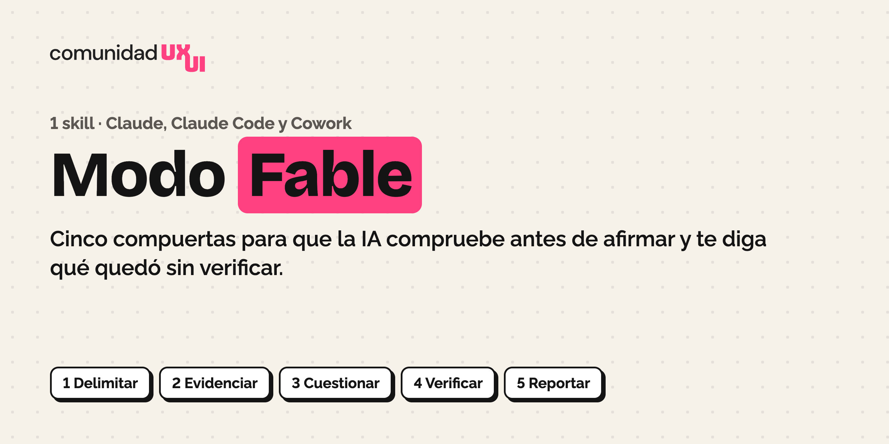
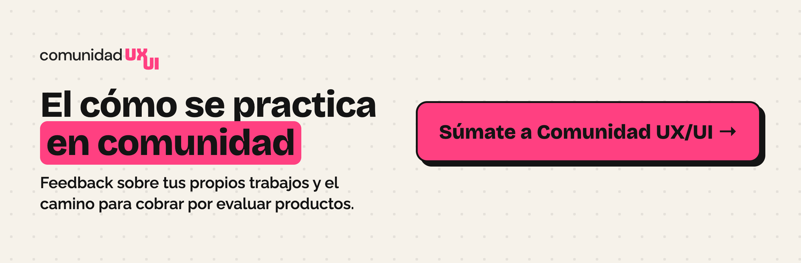

<p align="center"></p>

# Modo riguroso

**Un método de trabajo para que la IA haga bien las tareas difíciles a la primera:** las que tienen varios pasos, datos que todavía nadie miró o un error cuya primera explicación puede estar equivocada.

[](LICENSE)
[](skills/)
[](#en-claude-code)
[](#)

---

## Qué resuelve

La IA suele responder rápido y seguro, aunque la primera idea esté mal. Esta skill no le agrega inteligencia al modelo: le enseña a trabajar con disciplina. Toda tarea difícil pasa por cinco compuertas, en orden, y no se abre la siguiente hasta aprobar la anterior:

| # | Compuerta | Qué exige |
|---|---|---|
| 1 | **Delimitar** | Definir cómo se ve «terminado» y cómo se va a comprobar, antes de tocar nada |
| 2 | **Evidenciar** | Mirar los archivos y los datos reales antes de razonar |
| 3 | **Cuestionar** | Atacar la propia respuesta: buscar por qué la primera idea podría estar mal |
| 4 | **Verificar** | Comprobar que funciona antes de declararlo terminado |
| 5 | **Reportar** | Separar lo verificado de lo asumido, y decir qué quedó sin comprobar |

Sirve igual para diseño: planificar un research, revisar un informe antes de entregarlo o entender por qué un prototipo no se comporta como esperabas.

## Cómo se usa

Se activa sola cuando la tarea tiene muchas capas. También puedes pedirla: *«modo riguroso»*, *«piensa esto primero»*, *«baja el ritmo y haz esto bien»*.

## Instalación

### En claude.ai y en Cowork

1. Descarga `modo-riguroso.zip` desde **[Releases](https://github.com/CUXUI/modo-riguroso/releases/latest)**.
2. En Claude, entra a **Personalizar → Skills → + → Subir una skill** y súbelo tal como lo descargaste.
3. Abre un chat nuevo y pide lo que necesitas.

Guía paso a paso con capturas: **[cómo subir una skill a claude.ai](https://elegant-unicorn-d6c.notion.site/C-mo-instalar-una-skill-en-Claude-paso-a-paso-41afe4da3fb9819eaddac42060168977)**.

### En Claude Code

```
/plugin marketplace add CUXUI/modo-riguroso
/plugin install modo-riguroso@modo-riguroso
```

Después pide lo que necesitas o llama la skill directo: `/modo-riguroso`.

### En Codex, Cursor, Gemini CLI y otros agentes

```bash
npx skills add CUXUI/modo-riguroso
```

Necesita Node.js 22.20 o superior. Si tu agente no instala skills, deja el repositorio en tu carpeta de trabajo y pídele que lea el `SKILL.md` de la carpeta `skills/` y lo siga.

## Qué hay adentro

```
skills/modo-riguroso/
└── SKILL.md   las cinco compuertas y los hábitos permanentes
```

## Límites honestos

- **Es más lento a propósito.** Para una pregunta simple o un cambio de una línea, la propia skill indica saltear las compuertas.
- **No cambia el modelo:** cambia cómo trabaja. El mismo modelo con este método comete menos errores de apuro.
---

## Trabajar con rigor

El rigor también se entrena. Lo practicamos en **[Comunidad UX/UI](https://www.skool.com/comunidaduxui/about)** revisando trabajos reales con método.

<p align="center"><a href="https://www.skool.com/comunidaduxui/about"></a></p>

¿Prefieres empezar por correo? Suscríbete a **[Minuto UX](https://comunidad-uxui.kit.com/fb40f8e711)**, el newsletter de Comunidad UX/UI.

<p align="center"><a href="https://comunidad-uxui.kit.com/fb40f8e711"></a></p>


## Licencia

[CC BY-NC-SA 4.0](LICENSE). Puedes usarla, adaptarla y compartirla citando a Comunidad UX/UI, sin uso comercial y con la misma licencia.
